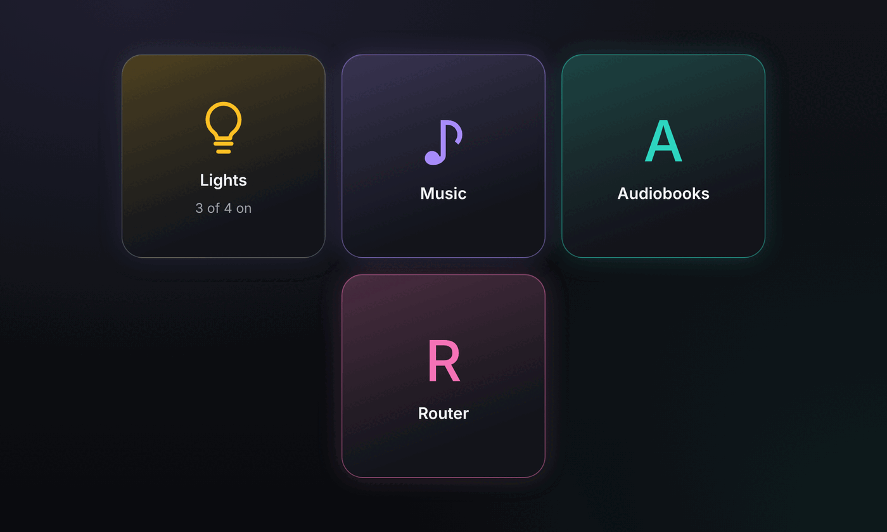
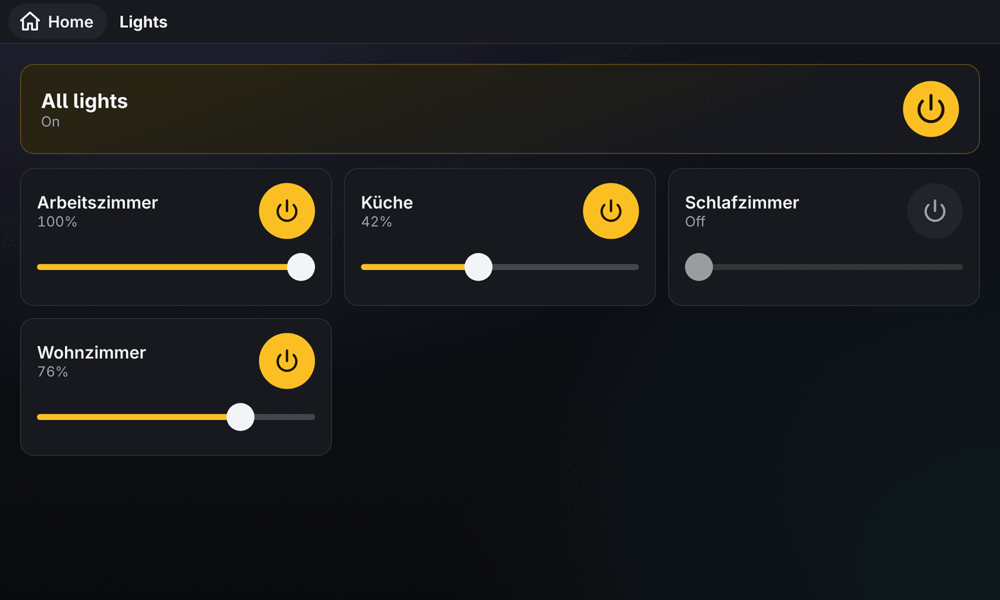
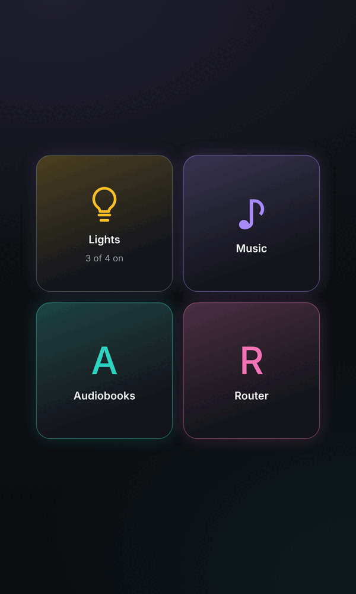
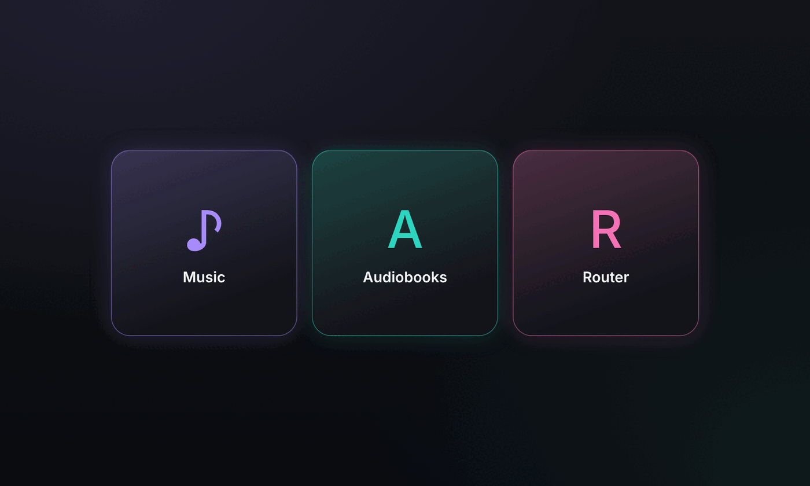

# kiosk-home

A small start page for a wall tablet: big app tiles that open your self-hosted web apps,
plus optional on/off and dimming for Philips Hue rooms.



> **Hobby project.** I built this for one Galaxy Tab A7 on my wall, my Hue Bridge and my
> homelab. It does what I need and not much more. Feel free to use it, fork it or take
> ideas from it, but expect no roadmap, no support and breaking changes whenever my setup
> changes.

## What it does

- **Dashboard**: one large tile per app from a `links.json` file, centred on the screen,
  each with its own accent colour. A built-in Lights tile shows how many rooms are on.
- **Apps open inside the page**: a tile opens the app full screen below a thin bar with a
  Home button, so a kiosk browser without navigation never gets stuck. Opened apps stay
  loaded in the background, so switching back is instant. The Android back button works
  too.
- **Lights**: an "All lights" switch, then one card per Hue room with an on/off toggle and
  a brightness slider. Rooms only, no single bulbs, colours or scenes.
- **Lights are optional**: with `KIOSK_LIGHTS=false` it is a plain app dashboard and never
  talks to a Hue Bridge.

| Lights view | Portrait | Without lights |
| --- | --- | --- |
|  |  |  |

One small Python (aiohttp) process serves the page and talks to the Hue Bridge over its
local API v2. The Hue app key stays on the server and never reaches the browser. The page
is plain HTML, CSS and JavaScript with no build step.

## Quick start

```
docker run -d -p 8080:8080 \
  -e KIOSK_HUE_HOST=192.0.2.10 \
  -e KIOSK_HUE_APP_KEY=your-hue-app-key \
  -v ./links.json:/config/links.json:ro \
  ghcr.io/m8-t/kiosk-home:0.4.0
```

Without Hue:

```
docker run -d -p 8080:8080 -e KIOSK_LIGHTS=false \
  -v ./links.json:/config/links.json:ro \
  ghcr.io/m8-t/kiosk-home:0.4.0
```

Open `http://<host>:8080/` and set it as the start page of your kiosk browser.

## Adding tiles

Tiles come from `links.json`, a JSON array. The file is read on every request, so edits
(or a changed Kubernetes ConfigMap) show up on the next page load without a restart.

```json
[
  {"title": "Music", "url": "https://music.example.org/", "icon": "♪"},
  {"title": "Audiobooks", "url": "https://books.example.org/", "icon": "A", "color": "#2dd4bf"},
  {"title": "Router", "url": "http://192.0.2.1/", "icon": "R", "open": "tab"}
]
```

| Field | Required | Meaning |
| --- | --- | --- |
| `title` | yes | Tile label |
| `url` | yes | Must start with `http://` or `https://` |
| `icon` | no | A character or emoji, drawn large in the tile colour. Default: the first letter of the title |
| `color` | no | Accent colour as `#rgb` or `#rrggbb`. Default: violet, teal, pink, green, orange, by position |
| `open` | no | `frame` (default) opens the app inside the page with the Home bar; `tab` navigates away like a normal link |

Tiles appear in file order. The Lights tile, when enabled, is always first and always
amber (grey when every light is off).

**When to use `"open": "tab"`**: some sites refuse to be shown inside another page (they
send `X-Frame-Options` or a `Content-Security-Policy` with `frame-ancestors`). The tile
then shows a blank or an error. kiosk-home cannot detect this, so set `tab` for those
sites. Note that a `tab` app has no Home bar; you get back with the browser's back
navigation.

An invalid `links.json` (bad JSON, missing title, unknown `open` value, bad colour) shows
an error message on the page instead of tiles.

## Configuration

| Variable | Default | Meaning |
| --- | --- | --- |
| `KIOSK_LIGHTS` | `true` | `false` turns off the whole Hue part: no Lights tile, no Hue settings needed. Accepts true/false/1/0/yes/no |
| `KIOSK_HUE_HOST` | required with lights | IP or host name of the Hue Bridge (HTTPS by default, an `http://` or `https://` prefix is accepted) |
| `KIOSK_HUE_APP_KEY` | required with lights | Hue application key, see below. Never logged |
| `KIOSK_LINKS_FILE` | `/config/links.json` | Path of the links file. Missing file means no tiles |
| `KIOSK_PORT` | `8080` | Listen port |
| `KIOSK_LOG_LEVEL` | `info` | `debug`, `info`, `warning` or `error` |

The server refuses to start with a clear message when a required variable is missing or a
value is invalid. Certificate checks are skipped for the Hue Bridge only, because it uses
a self-signed certificate.

### Create a Hue app key

Press the round link button on the Hue Bridge, then within 30 seconds run:

```
curl -sk -X POST https://<hue-ip>/api -d '{"devicetype":"kiosk-home#tablet"}'
```

The `username` value in the answer is your `KIOSK_HUE_APP_KEY`. Lights are controlled per
Hue room, and the "All lights" switch uses the bridge's built-in all-lights group, so one
tap is one request to the bridge.

## Kubernetes

Example manifests are in [`deploy/kubernetes/`](deploy/kubernetes/):

1. Create the `kiosk-home` secret from `secret.example.yaml` in the target namespace.
   Without lights, skip it and remove the `secretRef` from `deployment.yaml`.
2. Edit `configmap.yaml`: `KIOSK_HUE_HOST` (or `KIOSK_LIGHTS: "false"`) and your tiles in
   the `kiosk-home-links` ConfigMap.
3. `kubectl apply -k deploy/kubernetes/`
4. Expose it with `httproute.example.yaml` (Gateway API) or `ingress.example.yaml`.

There is no login. Keep it on your LAN or put it behind your own access control: anyone
who can open the page can switch your lights.

## HTTP API

The page uses these endpoints; they are handy for scripts too.

| Endpoint | Purpose |
| --- | --- |
| `GET /healthz` | Liveness, does not contact the Hue Bridge |
| `GET /api/config` | `{"lights": true}` or `false` |
| `GET /api/links` | The tiles from `links.json` |
| `GET /api/rooms` | `{"all": {"id", "on"} or null, "rooms": [{"id", "name", "on", "brightness"}]}` |
| `POST /api/rooms/{id}` | `{"on": true}` and/or `{"brightness": 1-100}`; brightness also turns a room on |
| `POST /api/all` | `{"on": true}` or `{"on": false}` for every light |

With `KIOSK_LIGHTS=false` the three lights endpoints answer 404. Hue Bridge errors come
back as 502 with a short message, which the page shows as a banner.

## Development

```
KIOSK_LIGHTS=false KIOSK_LINKS_FILE=./links.json python -m kiosk
python -m pytest -q -p no:cacheprovider tests
node --test tests/js/*.test.mjs
```

Needs Python 3.11 or newer with aiohttp, and Node 22 for the page tests. Releases are
built by GitHub Actions when a `v*.*.*` tag is pushed; the tag needs a matching section in
`CHANGELOG.md`, which becomes the release notes.

## License

[WTFPL](LICENSE). Do what you want with it.
